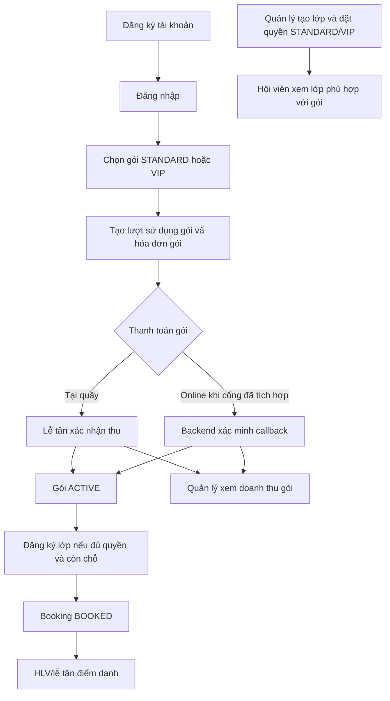

Cập nhật: 24/10/2026. Tài liệu dành cho người phụ trách frontend đọc hiểu, trình bày và trả lời khi bảo vệ đồ án. Nội dung đối chiếu với frontend và backend hiện có; không coi toàn bộ yêu cầu trong topic là chức năng đã hoàn thành.

## 1. Mục đích và phạm vi

Hệ thống quản lý vòng đời của một thành viên tại trung tâm: tạo tài khoản, sử dụng gói tập, đăng ký lớp, theo dõi lịch và điểm danh, thanh toán và xem kết quả tập luyện. Quản lý theo dõi hoạt động và doanh thu; lễ tân hỗ trợ giao dịch tại quầy; HLV phụ trách hoạt động chuyên môn.

Ba luồng bắt buộc của topic:

1. Quản lý người dùng và gói thành viên.
2. Quản lý lớp học, đăng ký lớp và lịch học.
3. Quản lý thanh toán và báo cáo.

Ba luồng tùy chọn: tập luyện và điểm danh; AI gợi ý bài tập; AI assistant.

| Môi trường                            | Nguồn dữ liệu                       | Cách hiểu khi trình bày                                                               |
| ------------------------------------- | ----------------------------------- | ------------------------------------------------------------------------------------- |
| Bản Vercel `sportiva-demo.vercel.app` | Dữ liệu demo lưu trên trình duyệt   | Dùng trình bày giao diện và mô phỏng nghiệp vụ; thao tác không ghi SQL backend local. |
| Bản local ở chế độ API                | Frontend → API backend → SQL Server | Dùng kiểm tra tích hợp thật khi các dịch vụ đang chạy. Một số chức năng tùy chọn hoặc tích hợp ngoài vẫn chưa có API.  |

Dữ liệu demo không tự đồng bộ giữa các trình duyệt/máy, cũng không tự đồng bộ sang SQL. API lỗi không tự chuyển sang dữ liệu demo.

## 2. Bốn vai trò

| Vai trò                  | Công việc chính                                                                                         | Giới hạn cần nhớ                                                                                                                                 |
| ------------------------ | ------------------------------------------------------------------------------------------------------- | ------------------------------------------------------------------------------------------------------------------------------------------------ |
| Center Manager — Quản lý | Quản lý thành viên, theo dõi đội ngũ, tạo/sửa/hủy lớp, phân công HLV, xem báo cáo và ghi nhận hoàn tiền | Giao diện có đội ngũ và ma trận quyền; backend chưa có API tạo nhân viên hoặc đổi vai trò tùy ý.                                                 |
| Coach — HLV              | Xem lịch phụ trách, điểm danh; tạo kế hoạch và ghi nhật ký tập luyện qua API                 | Backend có API kế hoạch/nhật ký; cần tiếp tục rà soát giới hạn quyền theo HLV phụ trách và hội viên.                                              |
| Member — Thành viên      | Đăng ký tài khoản, đăng ký/gia hạn gói, đặt/hủy lớp, xem lịch, điểm danh và hóa đơn của mình            | Không có quyền quản lý trung tâm. Backend phải kiểm tra quyền sở hữu dữ liệu, không chỉ dựa vào frontend.                                        |
| Receptionist — Lễ tân    | Tạo thành viên tại quầy, hỗ trợ gói và booking, điểm danh, lập hóa đơn và xác nhận thu tiền             | Theo nghiệp vụ cần tìm hồ sơ thành viên; API danh sách người dùng hiện chỉ cho quản lý, nên API mode có form phải nhập ID. Không được hoàn tiền. |

`MANAGER` là tên vai trò quản lý được code hỗ trợ thêm để tương thích với `CENTER_MANAGER`; khi trình bày topic vẫn nói bốn vai trò trên.

## 3. Luồng tổng quan xuyên suốt



Lớp không thu phí riêng. Quyền đặt lớp phụ thuộc vào gói đang `ACTIVE` và còn hạn: gói `STANDARD` vào được lớp `STANDARD`; gói `VIP` vào được cả lớp `STANDARD` và lớp `VIP`. Hóa đơn và các cổng thanh toán dùng để thu tiền mua/gia hạn gói, không gắn với booking lớp.
## 4. Flow 1 — Người dùng và gói thành viên (bắt buộc)

### 4.1. Đăng ký tài khoản

**Người thực hiện:** khách tự đăng ký hoặc lễ tân tạo thành viên tại quầy.

**Mục đích:** tạo hồ sơ tài khoản để sử dụng dịch vụ và liên kết với gói, booking, điểm danh, hóa đơn sau này.

1. Nhập họ tên, email, số điện thoại và mật khẩu; form đăng ký công khai có xác nhận mật khẩu.
2. Frontend kiểm tra trường bắt buộc, định dạng cơ bản và mật khẩu xác nhận.
3. Gửi yêu cầu đăng ký tới backend.
4. Backend kiểm tra dữ liệu, email/số điện thoại trùng, gán vai trò `MEMBER`, mã hóa mật khẩu rồi lưu tài khoản.
5. Tài khoản mới có trạng thái `ACTIVE`. Tự đăng ký xong chuyển về màn hình đăng nhập; tạo tại quầy thì cập nhật danh sách theo quyền truy cập hiện có.

**Kết quả:** có mã thành viên để dùng ở các nghiệp vụ tiếp theo; chưa tự phát sinh gói tập hoặc hóa đơn.

**Nhánh lỗi:** thiếu thông tin, email không hợp lệ, mật khẩu xác nhận sai, email/số điện thoại đã tồn tại hoặc mất kết nối. Frontend hiển thị lỗi và chỉ báo thành công khi nguồn dữ liệu xác nhận.

**Hiện trạng:** có API thật. API công khai chỉ tạo thành viên, không cho tự chọn làm quản lý/HLV/lễ tân.

### 4.2. Đăng nhập, phân quyền và đăng xuất

1. Người dùng nhập email và mật khẩu.
2. Backend kiểm tra tài khoản đang `ACTIVE` và mật khẩu khớp.
3. Thành công: backend trả JWT và thông tin người dùng; frontend lưu phiên, hiển thị dashboard/menu phù hợp.
4. Các request API tiếp theo gửi kèm JWT. Frontend chặn route sai vai trò; backend phải xác minh quyền cho từng request và tài nguyên.
5. Khi đăng xuất, frontend xóa phiên và cache tài khoản để tránh hiển thị dữ liệu người trước.

**Nhánh lỗi:** mật khẩu sai hoặc tài khoản không hoạt động thì không đăng nhập được; phiên hết hạn thì yêu cầu đăng nhập lại; không đủ quyền thì từ chối thao tác.

**Hiện trạng:** có API thật. Bản demo dùng phiên và tài khoản mô phỏng, không chứng minh JWT backend.

### 4.3. Quản lý thành viên và đội ngũ

1. Quản lý mở danh sách thành viên hoặc đội ngũ.
2. Tìm theo từ khóa, lọc trạng thái/vai trò và xem thông tin cơ bản.
3. Có thể tạo thành viên hoặc thay đổi trạng thái tài khoản: `ACTIVE`, `INACTIVE`, `BLOCKED`.
4. Dữ liệu danh sách được tải lại sau khi thao tác thành công.

**Cần phân biệt:** thay đổi trạng thái tài khoản không phải thay đổi vai trò. Danh sách nhân sự không đồng nghĩa đã có luồng tạo tài khoản nhân viên.

**Hiện trạng:** có API danh sách và cập nhật trạng thái cho quản lý. Cập nhật hồ sơ từ form, đổi mật khẩu, tạo nhân viên, gán quyền và nhật ký server còn thiếu endpoint tương ứng. Tìm kiếm/lọc danh sách hiện chủ yếu xử lý trên dữ liệu frontend đã tải.

### 4.4. Đăng ký gói hội viên

**Điều kiện:** hội viên tồn tại; gói đang hoạt động, còn hiệu lực và hội viên không có gói đang chờ thanh toán/trái quy tắc đăng ký hiện tại.

1. Chọn gói có tên, thời hạn, giá và cấp quyền (`STANDARD` hoặc `VIP`).
2. Thành viên đăng ký cho mình; lễ tân/quản lý có thể hỗ trợ theo quyền.
3. Backend tạo `member_subscriptions` ở `PENDING_PAYMENT` và hóa đơn `PENDING` theo giá gói.
4. Khi nhân viên xác nhận đã thu (hoặc cổng online được tích hợp xác minh thành công), hóa đơn thành `PAID`, subscription thành `ACTIVE`.
5. Gói VIP mở quyền đặt lớp STANDARD và VIP; gói STANDARD chỉ mở lớp STANDARD.

**Hiện trạng:** API đăng ký đã tạo subscription chờ thanh toán và hóa đơn; chức năng xác nhận hóa đơn kích hoạt gói. Database/API gói có giá và cấp quyền, không có phí theo từng lớp.
### 4.5. Gia hạn, hủy và hết hiệu lực gói

| Thao tác | Luồng và kết quả |
|---|---|
| Gia hạn | Chọn gói mới → backend tính kỳ mới nối tiếp ngày hết hạn hiện tại (nếu còn hạn) hoặc bắt đầu từ hôm nay → tạo subscription `PENDING_PAYMENT` và hóa đơn `PENDING` → thanh toán thành công mới kích hoạt kỳ mới. |
| Hủy gói | Chuyển subscription đang `ACTIVE` hoặc `PENDING_PAYMENT` thành `CANCELLED`. Hủy gói không tự hoàn hóa đơn đã trả; cần áp dụng chính sách hoàn riêng. |
| Hết hạn | Quyền lớp chỉ hợp lệ khi subscription `ACTIVE` và `end_date` chưa qua. Không khẳng định có job tự cập nhật mọi bản ghi thành `EXPIRED` nếu chưa có cơ chế đó. |
## 5. Flow 2 — Lớp học, booking và lịch (bắt buộc)

### 5.1. Quản lý tạo lớp và phân công HLV

**Điều kiện:** có bộ môn, phòng và tài khoản HLV; người tạo có quyền quản lý.

1. Nhập tên lớp, bộ môn, HLV, phòng, lịch, thời lượng, sức chứa và cấp gói tối thiểu để tham gia.
2. Cấp truy cập lớp là `STANDARD` hoặc `VIP`. Lớp thường chọn `STANDARD`; lớp đặc biệt chọn `VIP`.
3. Backend kiểm tra ID liên quan, HLV có vai trò COACH, thời gian tương lai, sức chứa phòng, xung đột lịch và cấp truy cập hợp lệ.
4. Lớp được tạo ở `SCHEDULED` và hiển thị nhãn yêu cầu gói để hội viên biết trước khi đăng ký.

Gói lưu `access_level` (`STANDARD`/`VIP`), còn lớp lưu `required_access_level`. Gói VIP được quyền vào lớp STANDARD và VIP; gói STANDARD chỉ vào lớp STANDARD. Nếu bổ sung cấp gói khác trong tương lai, cần mở rộng quy tắc so sánh cấp bậc một cách nhất quán.

**Hiện trạng:** API tạo lớp đã kiểm tra HLV, phòng, sức chứa và lịch; trường `requiredAccessLevel` mới được bổ sung vào entity/request/response/service và schema. Frontend cần gửi/hiển thị trường này.

### 5.2. Sửa lớp

1. Quản lý cập nhật thông tin hoặc cấp truy cập của lớp.
2. Khi đổi lớp STANDARD thành VIP, booking hiện có không tự hủy; quản lý cần cân nhắc thông báo và xử lý quyền lợi của các hội viên đã đăng ký.
3. Khi đổi từ VIP sang STANDARD, hội viên STANDARD có thể đăng ký mới nếu còn chỗ.
4. Không có giá lớp cần chốt lại; mọi khoản thu nằm ở gói hội viên.

### 5.3. Đăng ký lớp theo quyền gói hội viên

**Điều kiện:** tài khoản hoạt động; lớp `SCHEDULED`, chưa bắt đầu và còn chỗ; chưa có booking hiệu lực/trùng giờ; hội viên có subscription `ACTIVE`, chưa hết hạn; cấp gói đáp ứng `required_access_level` của lớp.

1. Hội viên xem lớp, thời gian, HLV/phòng, số chỗ còn và nhãn `STANDARD`/`VIP`.
2. Backend lấy hội viên từ JWT (hoặc cho nhân viên được quyền đặt hộ), tìm gói đang hoạt động và kiểm tra quyền vào lớp.
3. Nếu lớp STANDARD, gói STANDARD hoặc VIP được đăng ký. Nếu lớp VIP, chỉ gói VIP được đăng ký.
4. Backend kiểm tra không trùng lớp/giờ, lớp chưa bắt đầu và sức chứa còn; sau đó tạo booking trạng thái `BOOKED`.
5. Booking không tạo hóa đơn và không phát sinh thanh toán riêng cho lớp. Hội viên nâng cấp lên VIP bằng cách mua/gia hạn gói VIP, không trả thêm tiền theo từng lớp.

**Nhánh lỗi:** chưa có gói/đã hết hạn, gói STANDARD đăng ký lớp VIP, lớp hết chỗ/đã bắt đầu/bị hủy, lịch bị trùng hoặc booking đã tồn tại.

**Ràng buộc database:** mỗi cặp lớp–hội viên có một booking; sau khi hủy muốn đăng ký lại, service tái sử dụng bản ghi cũ. Database không thể tự xác minh quyền gói, nên backend phải kiểm tra subscription và cấp truy cập mỗi lần đặt.

**Hiện trạng:** backend đã kiểm tra hội viên có gói active, quyền sở hữu và các điều kiện lớp/chỗ/lịch; đã bổ sung kiểm tra `VIP` cho lớp đặc biệt. Không có giá lớp, giữ chỗ chờ thanh toán hay hóa đơn booking.

### 5.4. Hủy booking khác hủy lớp

| Nội dung | Hủy booking | Hủy lớp |
|---|---|---|
| Ai thực hiện | Hội viên hủy booking của mình; nhân viên được quyền hỗ trợ | Quản lý |
| Đối tượng | Một lượt đăng ký của một người | Cả lớp |
| Kết quả | Booking `CANCELLED`, chỗ được trả lại | Lớp `CANCELLED`, các booking liên quan được hủy theo xử lý hiện tại |
| Tiền | Không hoàn tiền vì booking không có phí riêng | Không phát sinh hoàn phí lớp; xử lý gói theo chính sách nếu trung tâm cam kết bù quyền lợi |

### 5.5. Xem lịch

- Hội viên xem lớp đã booking `BOOKED`; giao diện có thể lọc lớp theo quyền gói.
- HLV xem lớp được phân công qua `coachId`.
- Quản lý/lễ tân theo dõi lịch hoạt động để điều phối.
- Mỗi dòng lớp là một buổi cụ thể; chưa mô tả lịch lặp hằng tuần.
## 6. Flow 3 — Thanh toán gói hội viên và báo cáo (bắt buộc)

### 6.1. Tạo hóa đơn mua/gia hạn gói

Hóa đơn liên kết với `member_subscriptions` qua `subscription_id` (hoặc là khoản thu thủ công). Booking lớp không có hóa đơn vì lớp không thu phí riêng.

1. Hội viên chọn gói STANDARD hoặc VIP; giá và thời hạn lấy từ `membership_packages`.
2. Backend tạo subscription `PENDING_PAYMENT` và hóa đơn `PENDING` đúng giá gói.
3. Sau khi tiền được xác nhận, hóa đơn chuyển `PAID`, subscription chuyển `ACTIVE`.
4. Hủy booking không hủy gói và không hoàn tiền gói. Hủy subscription/hoàn tiền cần theo chính sách riêng.

**Hiện trạng:** luồng đăng ký/gia hạn đã tạo subscription chờ thanh toán và hóa đơn PENDING; khi nhân viên xác nhận hóa đơn đã trả, gói được kích hoạt. Cần sửa API lập hóa đơn để số tiền luôn do backend lấy từ gói, không cho client tự gửi số tiền/trạng thái PAID.

### 6.2. Thanh toán tại quầy và online

**Tại quầy:** lễ tân/quản lý kiểm tra đã nhận tiền rồi xác nhận hóa đơn `PENDING` thành `PAID`. Hệ thống kích hoạt subscription liên quan.

**Online theo thiết kế:** backend tạo `payment_transactions` cho hóa đơn gói, chuyển người dùng tới cổng, xác minh callback/webhook (chữ ký, mã đơn, số tiền), rồi mới cập nhật `PAID` và kích hoạt subscription. Kết quả quay về trình duyệt tự nó không phải bằng chứng đã thu tiền.

Danh mục hiện có VNPay, MoMo, ZaloPay và PayOS, nhưng cả bốn đang `is_enabled = 0`. Cần tích hợp, cấu hình khóa bí mật, xác minh callback và thử nghiệm từng cổng trước khi bật. Việc ghi tên cổng vào hóa đơn chưa chứng minh đã có giao dịch online thật.

**Hiện trạng:** API thu tiền tại quầy/đổi trạng thái hóa đơn đã có; chưa có checkout/callback online. Không có thanh toán/hoàn tiền theo từng booking lớp.

### 6.3. Hủy gói và hoàn tiền

Hủy subscription và hoàn hóa đơn là hai thao tác khác nhau. Quản lý duyệt hoàn theo chính sách; nếu đã thanh toán online, cần gọi cổng và chỉ ghi hóa đơn `REFUNDED` sau khi xác nhận kết quả. Việc hủy booking lớp không làm thay đổi hóa đơn gói.

### 6.4. Báo cáo doanh thu

Doanh thu phát sinh từ hóa đơn gói `PAID` (và các khoản thu thủ công nếu có), không phát sinh từ đăng ký lớp. Hóa đơn `REFUNDED` cần trừ khỏi doanh thu ròng hoặc hiển thị riêng. Schema có `paid_at`/`refunded_at`; báo cáo nên theo thời điểm thực thu/hoàn. API hiện đang tính theo `created_at`, cần điều chỉnh trước khi dùng làm báo cáo tài chính chính thức.
## 7. Flow 4 — Tập luyện và điểm danh (tùy chọn)

### 7.1. Điểm danh theo lớp — đã có API

1. HLV/lễ tân/quản lý chọn lớp và thành viên cần điểm danh.
2. Chọn `PRESENT` (có mặt) hoặc `ABSENT` (vắng).
3. Frontend gửi lớp, thành viên, người ghi nhận và trạng thái.
4. Backend kiểm tra các đối tượng tồn tại, trạng thái hợp lệ và chưa có điểm danh trùng cặp lớp/thành viên rồi lưu thời điểm ghi nhận.
5. Người có quyền xem lại theo lớp hoặc lịch sử thành viên.

**Giới hạn:** cần rà soát backend có xác nhận HLV phụ trách lớp, thời điểm buổi học và quyền của người ghi nhận trước khi điểm danh. Đây là điểm danh theo lớp, chưa có check-in độc lập lúc vào cửa trung tâm. Không trình bày tỷ lệ điểm danh là tỷ lệ tham dự trên mọi buổi dự kiến nếu công thức hiện chỉ tính trên các bản ghi đã có.

### 7.2. Kế hoạch, kết quả và nhận xét — có API backend

1. HLV chọn thành viên, đặt mục tiêu và tạo kế hoạch gồm các bài tập.
2. Thành viên xem kế hoạch của mình.
3. HLV ghi kết quả buổi tập và nhận xét; thành viên theo dõi tiến độ từ thông tin đã ghi.
4. Ở API mode dữ liệu được lưu qua backend; ở demo, phần hiển thị có thể dùng dữ liệu giả lập trên trình duyệt.

**Hiện trạng:** backend có API kế hoạch, nhật ký tập luyện và chi tiết bài tập. Cần kiểm tra quyền truy cập dữ liệu theo hội viên/HLV; không nên gọi module này chỉ là demo. AI gợi ý vẫn là mô phỏng ở frontend.

## 8. Flow 5 — AI gợi ý bài tập (tùy chọn)

**Nghiệp vụ mục tiêu trong topic:** HLV cung cấp mục tiêu, trình độ và lịch sử tập luyện → hệ thống AI gợi ý bài tập → HLV xem xét/điều chỉnh → sử dụng trong kế hoạch.

**Bản hiện tại:** nhập mục tiêu, mức độ và thời gian rảnh → frontend chọn mẫu bài tập theo quy tắc → hiển thị gợi ý; có thể lưu mẫu cá nhân trong demo. Chưa gọi mô hình AI, chưa phân tích lịch sử sức khỏe/tập luyện đầy đủ và chưa có API backend.

Khi bảo vệ nên gọi là “mô phỏng luồng gợi ý bài tập”, không khẳng định AI cá nhân hóa đã hoạt động thật.

## 9. Flow 6 — AI assistant (tùy chọn)

**Nghiệp vụ mục tiêu trong topic:** thành viên đặt câu hỏi về lớp, lịch tập, bài tập hoặc dịch vụ → hệ thống lấy ngữ cảnh được phép → AI trả lời phù hợp.

**Bản hiện tại:** người dùng nhập câu hỏi → frontend nhận diện từ khóa/quy tắc → tra dữ liệu demo và trả lời. Chưa có mô hình AI, API hội thoại hoặc lưu trữ hội thoại ở backend.

## 10. Các nghiệp vụ hỗ trợ khác

| Nghiệp vụ         | Luồng mục tiêu và hiện trạng                                                                                                                               |
| ----------------- | ---------------------------------------------------------------------------------------------------------------------------------------------------------- |
| Hỗ trợ thành viên | Thành viên gửi phiếu → lễ tân tiếp nhận → xử lý → đánh dấu giải quyết. Backend đã có API tạo, tra cứu và xử lý phiếu; cần xác minh thêm phân quyền xem chi tiết từng phiếu.         |
| Thông báo         | Cần gửi khi đổi/hủy lịch, gần hết gói và các sự kiện liên quan. Hiện có dữ liệu/thông báo minh họa trong demo; chưa có dịch vụ thông báo đầy đủ ở backend. |
| Nhật ký thao tác  | Quản lý cần biết ai làm gì và khi nào. Demo có log trình duyệt; chưa phải audit log server có kiểm soát truy cập và chống sửa.                             |
| Phòng/bộ môn/gói  | Quản lý cần duy trì danh mục trước khi vận hành. Backend có API đọc/thêm bộ môn, phòng và gói; cần bổ sung/chỉnh sửa/xóa danh mục nếu quy trình quản trị yêu cầu.                                       |
| Phân quyền        | Theo topic, quản lý cấp quyền cho từng vai trò. Hiện có route guard và quyền cố định; chưa có luồng quản lý quyền tùy ý đầy đủ.                            |

## 11. Phân biệt các đối tượng nghiệp vụ

| Đối tượng | Ý nghĩa |
|---|---|
| Tài khoản/thành viên | Người sử dụng; vai trò xác định nhóm quyền. Tạo tài khoản chưa đồng nghĩa mua gói. |
| Gói (`MembershipPackage`) | Thời hạn, giá và cấp quyền `STANDARD`/`VIP`. |
| Lượt sử dụng gói (`MemberSubscription`) | Quyền sử dụng gói của thành viên trong khoảng thời gian; chỉ `ACTIVE` và chưa hết hạn mới được dùng để đặt lớp. |
| Lớp (`Classes`) | Một buổi cụ thể, có bộ môn, HLV, phòng, sức chứa và `required_access_level`; không có giá lớp riêng. |
| Booking (`ClassBooking`) | Hội viên đủ điều kiện ghi danh vào lớp; không phát sinh hóa đơn riêng. |
| Hóa đơn (`Invoice`) | Khoản tiền mua/gia hạn gói hoặc khoản thu thủ công; lớp không liên kết hóa đơn. |
| Giao dịch (`PaymentTransaction`) | Một lần thử thu/hoàn cho hóa đơn gói. |
| Điểm danh (`Attendance`) | Ghi nhận có mặt/vắng; booking không đồng nghĩa đã tham gia buổi tập. |

Quy tắc cấp quyền: gói STANDARD → lớp STANDARD; gói VIP → lớp STANDARD và VIP. Booking hợp lệ cần subscription `ACTIVE`, ngày hết hạn còn hiệu lực, lớp `SCHEDULED`, còn chỗ và không trùng lịch.
## 12. Đường đi FE–BE để giải thích khi bảo vệ

```text
Hội viên chọn lớp
→ Frontend gửi yêu cầu kèm JWT
→ Backend kiểm tra người dùng, gói ACTIVE/còn hạn và cấp STANDARD/VIP
→ Backend kiểm tra lịch, booking trùng và sức chứa
→ Đủ điều kiện thì tạo booking BOOKED; không tạo hóa đơn lớp
→ Hội viên xem lịch và HLV/lễ tân điểm danh
```

Thanh toán online chỉ nằm ở luồng mua/gia hạn gói: backend tạo giao dịch cho hóa đơn gói, cổng trả kết quả, backend xác minh rồi mới kích hoạt subscription. Trang frontend không tự xác nhận thanh toán thành công.

| Luồng | Trang frontend chính | API tiêu biểu — tiền tố `/api/v1` |
|---|---|---|
| Tài khoản | `Auth.tsx`, `Members.tsx`, `Settings.tsx` | `POST /users/register`, `POST /users/login`, `GET /users`, `PATCH /users/{id}/status` |
| Gói | `Memberships.tsx` | `GET/POST /memberships/packages`, `POST /memberships/subscribe`, renew/cancel |
| Lớp | `Classes.tsx`, `Schedule.tsx` | `GET/POST /classes`, `PUT /classes/{id}`, `POST /classes/{id}/cancel`; request/response có cấp truy cập |
| Booking | `Classes.tsx`, `Bookings.tsx` | `POST /classes/{id}/book?memberId=...`, `DELETE /bookings/{id}`; backend kiểm tra quyền gói |
| Hóa đơn gói | `Payments.tsx` | `POST /payments/invoices`, `POST /payments/invoices/{id}/pay`, `POST /payments/invoices/{id}/refund` |
| Thanh toán online gói | `Payments.tsx` | Checkout/callback từng nhà cung cấp: cần hoàn thiện, chưa hoạt động |
| Báo cáo | `Reports.tsx` | `/payments/revenue`; nên chuyển sang thời điểm thu/hoàn |
| Điểm danh | `Attendance.tsx` | `POST /attendance`, `GET /attendance/classes/{id}`, `GET /attendance/members/{id}` |

## 13. Kịch bản trình bày khoảng 6–7 phút

1. **Giới thiệu:** bốn vai trò và đang trình bày demo hay API local.
2. **Mua gói:** chọn STANDARD/VIP, tạo hóa đơn `PENDING`, xác nhận thanh toán và chỉ ra quyền gói được kích hoạt.
3. **Tạo lớp:** quản lý tạo lớp thường (`STANDARD`) và lớp đặc biệt (`VIP`), phân công HLV/phòng.
4. **Kiểm tra quyền:** tài khoản STANDARD thử lớp thường được; thử lớp VIP bị từ chối. Tài khoản VIP có thể đăng ký cả hai nếu còn chỗ và không trùng lịch.
5. **Lịch và điểm danh:** booking thành công thì xuất hiện trên lịch; HLV/lễ tân điểm danh.
6. **Báo cáo:** quản lý xem doanh thu từ hóa đơn gói đã `PAID`; lớp không tạo khoản thu riêng.
7. **Kết thúc:** phân biệt phần API đã có với tích hợp thanh toán online còn cần hoàn thiện.
## 14. Quyền lợi VIP có thể bổ sung

Nên bắt đầu với các quyền dễ giải thích và dễ kiểm soát:

1. **Đăng ký lớp VIP độc quyền** — đã là khác biệt chính giữa STANDARD và VIP.
2. **Ưu tiên mở đăng ký** — VIP được đặt trước STANDARD một khoảng thời gian; cần quy định thời điểm mở booking và giới hạn giữ chỗ.
3. **Một buổi đánh giá thể lực/tháng** — lợi ích có giá trị, nhưng cần ghi nhận lượt đã sử dụng để tránh dùng quá số lần.
4. **Một lượt khách mời/tháng** — giúp thành viên trải nghiệm và quảng bá trung tâm; cần mã lượt, hạn dùng và quy tắc khách.
5. **Ưu đãi dịch vụ PT hoặc workshop** — nên ghi rõ số buổi/giảm giá và thời hạn, tránh hứa “không giới hạn”.
6. **Tiện ích tại trung tâm** như tủ đồ/khăn/đồ uống — chỉ nên bán kèm nếu trung tâm có khả năng phục vụ ổn định.

**Gợi ý chọn gói ban đầu:** VIP gồm lớp VIP + ưu tiên đặt lớp + một quyền lợi có giới hạn (đánh giá thể lực hoặc lượt khách mời). Các quyền lợi còn lại có thể bổ sung sau khi vận hành. Quyền lợi có hạn mức cần được lưu và trừ lượt sử dụng; chỉ ghi mô tả trên tên gói thì backend không thể kiểm soát việc sử dụng.

## 15. Câu trả lời thường gặp

| Câu hỏi | Cách trả lời |
|---|---|
| Lớp có thu phí riêng không? | Không. Hội viên mua gói; gói đang hiệu lực quyết định lớp nào họ được đăng ký. |
| Gói STANDARD đăng ký lớp VIP được không? | Không. Lớp VIP yêu cầu gói VIP. Gói VIP vẫn đăng ký được lớp STANDARD. |
| Gói hết hạn thì sao? | Không thể đăng ký lớp mới cho tới khi có gói hợp lệ; booking cũ cần theo chính sách của trung tâm. |
| Bấm đăng ký lớp có cần thanh toán thêm không? | Không. Nếu gói phù hợp và còn chỗ thì booking được xác nhận; thanh toán chỉ ở luồng mua/gia hạn gói. |
| Thanh toán online đã chạy chưa? | Database đã có danh mục bốn cổng nhưng mặc định tắt; phải hoàn thiện tích hợp và xác minh callback trước khi thu tiền thật. |
| Có booking nghĩa là đã tập chưa? | Chưa. Cần điểm danh để ghi nhận có mặt/vắng. |
| AI đã chạy thật chưa? | Chưa; phần gợi ý hiện là mô phỏng theo quy tắc. |


