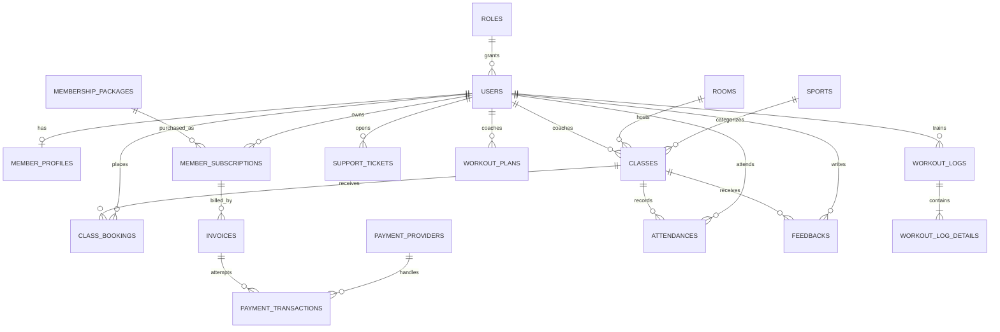

# Database design — Sports Center Management System

## 1. Current database review

The project is configured for SQL Server and Hibernate uses ddl-auto: validate, so the application expects tables to exist before startup. The repository only had V1__core_flows.sql; the project does not include Flyway, so that file was not being applied automatically.

The old SQL does not match the current JPA entities. Examples:

| Current code expects | Old SQL defined |
| --- | --- |
| users.user_id, users.role_id and a roles table | users.id and a text role; no matching roles table |
| membership_packages, member_subscriptions | memberships, user_memberships |
| classes.class_id, class_name, sport_id, coach_id, room_id, schedule_time | a different classes shape plus a separate class_schedules table |
| invoice subscription_id, member_id, amount, payment_status | user_membership_id, user_id, total_amount, and no payment status |
| class_bookings with status BOOKED/CANCELLED | class_enrollments with status REGISTERED/CANCELLED |

As a result, a fresh database created from the old SQL is not a reliable schema for this application. The old script also had a dangling conditional around its sample package insert.

## 2. Proposed relationships

`membership_packages.access_level` controls which classes a subscription can access; `classes.required_access_level` states the minimum level. One `classes` row represents one scheduled class/session, matching the current entity. A recurring timetable can be modeled separately if required.
## 3. Membership access and payment decisions

- Classes do not have a separate booking fee. Revenue comes from selling or renewing a membership package.
- Membership packages have an `access_level`: `STANDARD` or `VIP`. A class has a `required_access_level`: `STANDARD` or `VIP`.
- A valid active STANDARD membership grants access to STANDARD classes. VIP grants access to both STANDARD and VIP classes.
- Booking a class creates a `BOOKED` reservation directly after the service checks the member's active, unexpired subscription, access level, capacity, schedule and duplicate booking. No class invoice or payment hold is created.
- An invoice is linked to a membership subscription through `subscription_id`, or represents a manual charge. Online payment attempts are for package invoices.
- `payment_transactions` stores payment/refund attempts and provider references. A verified successful package payment changes its invoice to `PAID` and activates the subscription.
- Failed/expired online attempts remain in transaction history. The invoice can stay pending for retry while valid.
- The provider catalog contains VNPay, MoMo, ZaloPay and PayOS. Seed entries start disabled; each provider still needs credentials, request signing, callback verification and sandbox checks before enabling.
## 4. Tables

| Table | Purpose |
|---|---|
| roles, users, member_profiles | Accounts, access role and member profile |
| sports, rooms, classes | Sport catalog, rooms, scheduled classes and required access level |
| membership_packages, member_subscriptions | Package price/access level, duration and a member's active period |
| class_bookings | A member's confirmed or cancelled place in a class |
| invoices | Amount owed for a membership subscription or manual charge |
| payment_providers | Gateway catalog and whether its backend integration is enabled |
| payment_transactions | Individual package payment/refund attempts and provider references |
| attendances | Attendance record, unique per member and class |
| feedbacks, support_tickets | Member feedback and support requests |
| workout_plans, workout_logs, workout_log_details | Coach plans and recorded exercise results |
## 5. Key constraints and indexes

- Foreign keys connect members, roles, coaches, sports, rooms, subscriptions, bookings and invoices.
- Package and class access levels are constrained to `STANDARD` or `VIP`; service logic grants VIP access to both levels.
- Class capacity and duration are validated; the service must ensure a coach and room are not double-booked.
- A class/member pair has one booking row. After cancellation, application logic can reuse the existing row if the member books again.
- Attendance is unique per class/member so concurrent requests cannot create duplicate check-ins.
- An invoice can point to a membership subscription or be a manual charge. Class bookings do not create invoices.
- A membership invoice can have multiple payment transaction attempts.
- Gateway order references and non-null provider transaction references are unique for idempotent callback handling.
- Provider seed records for VNPay, MoMo, ZaloPay and PayOS are disabled until their backend integrations and credentials are ready.
- The database checks values and relationships, while the service must still enforce rules such as “selected user has the COACH role,” “membership is active and unexpired,” “membership access level meets the class requirement,” and “class has places left.”
## 6. Schema file and migration safety

`src/main/resources/db/schema.sql` is the proposed SQL Server baseline for a newly created, empty SportsCenterDB. It includes membership/class access levels and online payment structures for package invoices. It does not add a class price or class-linked invoice.

This script does not alter or migrate existing tables. For a database that already has data:

1. Back up the database.
2. Compare the real database columns/data with this design.
3. Add `access_level` to packages and `required_access_level` to classes, backfilling existing rows as `STANDARD`.
4. Remove any previously introduced class price, booking price/checkout fields, and invoice-to-booking relation only after confirming no live data depends on them.
5. Validate the migration against a disposable copy before switching the application.

The schema is run manually and is not applied automatically at startup. The project uses Hibernate validation; it is not a migration tool.
## 7. Current code versus database design

The Java code now maps `access_level` on membership packages and `required_access_level` on classes. Class creation/updates expose the required level, and booking checks that the member's active package grants access. Class price, booking price snapshots, class-payment invoices and checkout holds are intentionally not part of this model.

The SQL schema still prepares `payment_providers` and `payment_transactions` for online package purchases. Their Java entities/services and the checkout/callback verification for VNPay, MoMo, ZaloPay and PayOS remain to be implemented. Until that work is complete, provider rows stay disabled and only existing payment flows should be presented as available.
