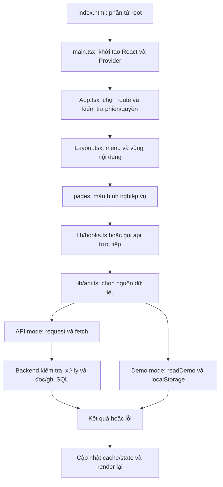
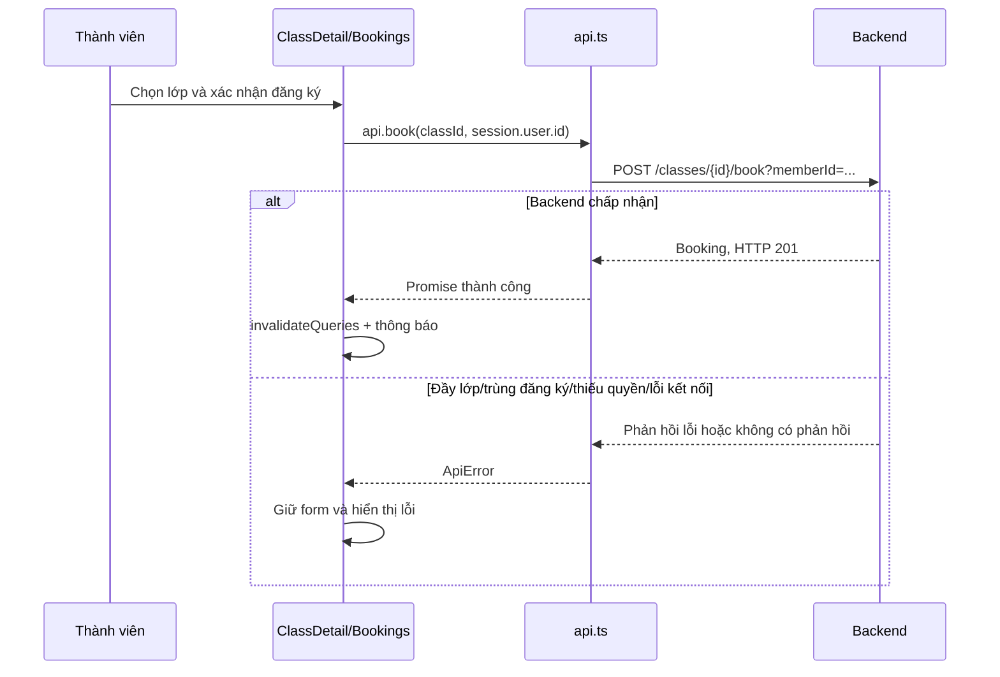

# Giải thích frontend để đọc code và bảo vệ đồ án

Tài liệu mô tả **code đang có**, không thay thế topic yêu cầu. Các comment tiếng Việt trong source chỉ giải thích; không thêm chức năng hay thay đổi nghiệp vụ. Nên đọc lần lượt `main.tsx`, `App.tsx`, `lib/auth.tsx`, `lib/hooks.ts`, `lib/api.ts`, rồi các trang của từng flow.

## 1. Em phụ trách frontend làm những gì?

Frontend nhận thao tác người dùng, kiểm tra dữ liệu nhập cơ bản, lựa chọn màn hình/nút theo vai trò, gọi API và trình bày kết quả. Backend xác thực JWT, kiểm tra quyền với tài nguyên, xử lý nghiệp vụ và ghi database. Trình duyệt không kết nối trực tiếp SQL Server.

Ví dụ khi đăng ký lớp: frontend gửi ID lớp và thành viên, hiển thị đang xử lý, chờ backend xác nhận, rồi lấy lại dữ liệu để cập nhật số chỗ. Việc một chỗ có còn tại thời điểm lưu hay không phải được backend kiểm tra; con số trên màn hình có thể đã cũ khi hai người cùng thao tác.

## 2. Đường đi chung của chương trình



| File/thư mục                     | Để làm gì                                                | Điều cần giải thích được                                                  |
| -------------------------------- | -------------------------------------------------------- | ------------------------------------------------------------------------- |
| `main.tsx`                       | Gắn React vào trang HTML, bọc các Provider               | Vì sao toàn bộ trang dùng được phiên và cache chung                       |
| `App.tsx`                        | Khai báo URL, lazy loading, route guard                  | Chặn chưa đăng nhập và chặn sai vai trò khác nhau thế nào                 |
| `components/Layout.tsx`          | Khung trang, menu theo vai trò, tìm kiếm, menu tài khoản | Menu là giao diện; không thay kiểm tra quyền API                          |
| `components/ui.tsx`              | Form, modal, bảng, nút, thông báo dùng chung             | Vì sao form chờ API, lỗi không đóng, bảng dùng lại được                   |
| `lib/types.ts`                   | Mô tả cấu trúc dữ liệu TypeScript                        | Kiểu dữ liệu không tự xác minh mọi JSON lúc runtime                       |
| `lib/auth.tsx`                   | Quản lý đăng nhập/đăng xuất, hết phiên                   | Token/sessionStorage, xóa cache khi đổi người dùng                        |
| `lib/hooks.ts`                   | Các query/mutation dùng lại                              | `queryKey`, `enabled`, `invalidateQueries`                                |
| `lib/api.ts`                     | Ánh xạ hàm nghiệp vụ tới endpoint hoặc demo              | Method, URL, payload, JWT và lỗi HTTP                                     |
| `lib/demo.ts`                    | Tạo/lưu dữ liệu demo                                     | LocalStorage không tự đồng bộ SQL                                         |
| `lib/catalog.ts`                 | Tra tên phòng/bộ môn từ dữ liệu demo                     | API mode chưa có nguồn danh mục tương ứng                                 |
| `lib/utils.ts`                   | Ngày giờ, tiền, tìm kiếm, CSV                            | UTC+7, số tiền dạng number, escape CSV                                    |
| `pages/`                         | Ghép giao diện và xử lý từng flow                        | Từ nút bấm lần ra handler và hàm API                                      |
| `styles.css`, `styles-pages.css` | Giao diện chung, từng trang, responsive, bản in          | CSS thay trình bày, không thay dữ liệu hay quyền                          |
| `vite.config.ts`                 | Dev server, build, proxy, môi trường test                | Proxy dev không tự tồn tại trên hosting khác                              |
| `lib/openapi.d.ts`               | Type được sinh từ Swagger tham khảo                      | Không sửa tay file sinh tự động; model thực tế xem `types.ts` và contract |

## 3. Bốn vai trò trong topic và cách code thể hiện

| Vai trò        | Vai trò trong các flow                                                  | Cách đọc code                                                      |
| -------------- | ----------------------------------------------------------------------- | ------------------------------------------------------------------ |
| Center Manager | Quản lý thành viên/nhân sự/lớp; xem báo cáo                             | `isManager`, nhóm route quản lý, các nút tạo/sửa/hủy lớp           |
| Coach          | Xem lịch phụ trách, danh sách lớp, điểm danh; trải nghiệm kế hoạch demo | `useClasses` gửi `coachId` của mình; kiểm tra `COACH` tại trang    |
| Member         | Đăng ký tài khoản, gói, lớp, lịch và hóa đơn của mình                   | `session.user.id` giới hạn người thao tác; backend kiểm tra sở hữu |
| Receptionist   | Hỗ trợ tạo thành viên, gói, đặt lớp, điểm danh, hóa đơn                 | Các form chọn/nhập memberId và quyền của API tương ứng             |

`MANAGER` là tên vai trò quản lý tương thích được code hỗ trợ bên cạnh `CENTER_MANAGER`. Đây không phải vai trò thứ năm trong bài trình bày topic.

Helper `isStaff` hiện chỉ gồm quản lý và lễ tân, không gồm HLV. Đừng suy luận mọi chỗ ghi “staff” đều có COACH.

Một giới hạn cần nói đúng: API danh sách `/users` chỉ dành cho quản lý. `useUsers` vì vậy không tải toàn bộ danh sách cho lễ tân; một số form của lễ tân cần nhập ID. Có trang dành cho một vai trò không có nghĩa vai trò đó được mọi endpoint trong trang cấp dữ liệu đầy đủ.

## 4. Flow 1 bắt buộc: người dùng và gói thành viên

### 4.1. Đăng ký và đăng nhập

1. `pages/Auth.tsx` nhận submit, gọi `preventDefault` để tránh form reload toàn trang.
2. `FormData` lấy email, mật khẩu và thông tin cần thiết. Đăng ký kiểm tra hai lần nhập mật khẩu khớp.
3. `api.register` gọi `POST /api/v1/users/register`. Vai trò công khai là MEMBER, không cho tự chọn quản lý.
4. Đăng ký xong về login. `api.login` gọi `POST /api/v1/users/login` với email/password.
5. Phản hồi hợp lệ có token và user. `signIn` trong `AuthProvider` lưu Session vào sessionStorage, xóa cache tài khoản cũ và cập nhật state.
6. `navigate('/')` về tổng quan; route guard đọc cùng Session để cho vào trang.

**Câu trả lời mẫu:** “Frontend gom dữ liệu form và gọi API đăng nhập. Backend xác thực tài khoản rồi cấp JWT. Em lưu phiên theo tab để dùng cho các request tiếp theo; frontend không tự sinh JWT và không lưu mật khẩu.”

`getSession` kiểm tra cấu trúc phiên, không xác minh chữ ký JWT. Effect đọc `exp` giúp giao diện chủ động hết phiên; backend vẫn là nơi quyết định token có hợp lệ hay không.

### 4.2. Danh sách thành viên và nhân sự

`Members.tsx` dùng chung cho trang thành viên và đội ngũ qua prop `team`. Query tải Users, sau đó lọc nhóm MEMBER/khác MEMBER, từ khóa, trạng thái và vai trò ngay trên mảng đã nhận. Đây là tìm kiếm/lọc phía client, không phải API tìm kiếm hoặc phân trang SQL.

Tạo thành viên tại quầy vẫn dùng `api.register`. Đổi trạng thái dùng `api.status` → `PATCH /users/{id}/status?status=...`. Thay ACTIVE/INACTIVE/BLOCKED khác với gán role. Giao diện hiện chưa có chức năng phân quyền tùy ý như toàn bộ topic mô tả.

### 4.3. Đăng ký/gia hạn gói

1. `Memberships.tsx` chọn memberId: MEMBER lấy từ phiên; nhân viên chọn người hỗ trợ.
2. `api.subscriptions(memberId)` lấy lịch sử gói theo thành viên.
3. Gói được coi là còn hiệu lực trên UI khi `status === 'ACTIVE'` và endDate chưa qua ngày hiện tại.
4. Khi xác nhận, `api.subscribe(memberId, packageId, renewId)` chọn endpoint đăng ký hoặc gia hạn.
5. Không có renewId: `POST /memberships/subscribe` với `{memberId, packageId}`.
6. Có renewId: `POST /memberships/{id}/renew?packageId=...`.
7. Thành công: đánh dấu cache cũ để tải lại. Ngày bắt đầu/kết thúc do backend tính, không tin ngày tự gửi từ form.

**Điểm dễ bị hỏi:** Đăng ký gói và thu tiền là hai thao tác riêng trong code hiện tại. Lưu gói không tự tạo hóa đơn. Hủy gói không tự hoàn tiền. Notice của giao diện nêu rõ gia hạn hiện tính kỳ mới từ hôm nay và không cộng dồn ngày còn lại; không nên trình bày khác hành vi đang có.

API mode chưa có endpoint danh mục gói cho màn này nên dùng packageId trong DB. Thẻ giá và quyền lợi đầy đủ đang dùng danh mục demo.

## 5. Flow 2 bắt buộc: lớp học, đặt chỗ và lịch

### 5.1. Tạo/sửa lớp và phân công HLV

`Classes.tsx` và `ClassForm` dùng chung giữa danh sách và lịch. Có `item.id` là sửa, chưa có là tạo. Form chuyển các ID, sức chứa và thời lượng thành number rồi gửi `api.saveClass`.

| Trường            | Ý nghĩa                                      |
| ----------------- | -------------------------------------------- |
| `sportId`         | Lớp thuộc bộ môn nào                         |
| `coachId`         | HLV phụ trách lớp: đây là thao tác phân công |
| `roomId`          | Phòng tổ chức                                |
| `maxCapacity`     | Số chỗ tối đa                                |
| `scheduleTime`    | Ngày giờ bắt đầu theo trung tâm              |
| `durationMinutes` | Thời lượng buổi học                          |

Không có id → POST `/classes`; có id → PUT `/classes/{id}`. FormModal chỉ đóng sau Promise thành công. `invalidateQueries` khiến các màn đang hiển thị lấy lại lớp/sức chứa mới.

Trong API mode, tên phòng/bộ môn có thể hiện theo ID vì chưa có endpoint danh mục. Không nên nói frontend đã tự đọc đầy đủ danh mục SQL nếu thực tế chỉ nhập ID.

### 5.2. Đặt lớp



memberId của endpoint đặt lớp nằm trong **query string**, không phải JSON body. MEMBER dùng ID của phiên; nhân viên hỗ trợ chọn người học. Frontend khóa nút khi biết lớp hết chỗ/đã bắt đầu, nhưng điều đó không thay kiểm tra backend tại thời điểm đặt.

Danh sách booking lấy theo thành viên hoặc lớp. Backend hiện không có route lấy toàn bộ booking nên UI chỉ bật query khi có phạm vi hợp lệ. `classId` được ưu tiên nếu cùng truyền cả hai.

### 5.3. Hủy đăng ký khác hủy lớp

- `api.cancelBooking(id)` gọi DELETE `/bookings/{id}`: hủy một chỗ của một thành viên. Luồng demo chuyển trạng thái CANCELLED để giữ lịch sử; bài test API local đã xác nhận hủy/đặt lại được.
- `api.cancelClass(id)` gọi POST `/classes/{id}/cancel`: quản lý hủy tổ chức lớp. Không gọi nhầm khi chỉ muốn trả chỗ cho một học viên.

### 5.4. Lịch cá nhân và lịch HLV

`Schedule.tsx` dùng chính danh sách Classes; mỗi lớp có thời gian bắt đầu và thời lượng. Frontend tính bảy ngày từ thứ Hai theo tuần đang xem, rồi lọc lớp vào khoảng ngày đó.

MEMBER chọn lịch cá nhân: nối booking BOOKED với classId. HLV: `useClasses` đã gửi `coachId=session.user.id` để nhận lớp phụ trách. Không có bảng dữ liệu frontend riêng tên “lịch cá nhân” cần lưu song song với booking.

## 6. Flow 3 bắt buộc: thanh toán và báo cáo

### 6.1. Tạo hóa đơn, thu tiền, hoàn tiền

1. `Payments.tsx` chọn thành viên, nhập amount dạng number, phương thức, subscriptionId tùy chọn.
2. `api.invoice` POST `/payments/invoices`; form chủ động gửi `paymentStatus: 'PENDING'`.
3. Tạo xong mới xem phiếu thu; chưa coi là đã nhận tiền.
4. Nhân viên kiểm tra đã thu tiền rồi xác nhận qua `api.pay(id)` → POST `/payments/invoices/{id}/pay`.
5. Quản lý ghi nhận hoàn tiền bằng `api.pay(id, true)` → `/refund`; quyền và trạng thái hợp lệ còn phải kiểm tra ở backend.
6. Phản hồi server cập nhật chi tiết hóa đơn đang mở và làm mới query.

```text
PENDING --xác nhận thu tiền--> PAID --quản lý ghi nhận hoàn tiền--> REFUNDED
```

**Câu trả lời mẫu:** “Em tách bước lập hóa đơn và xác nhận đã thu tiền để tránh việc mới tạo phiếu đã cộng vào doanh thu. Các nút pay/refund của phiên bản này ghi trạng thái nghiệp vụ; không tự chuyển tiền qua ngân hàng.”

Có `BANK_TRANSFER`, `CREDIT_CARD`, `VNPAY` trong danh sách lựa chọn không có nghĩa đã tích hợp SDK/callback giao dịch tương ứng. Không nên nhận đã tích hợp cổng thanh toán khi chưa có luồng đó.

### 6.2. Hóa đơn hiển thị và bản in

Có memberId thì API trả hóa đơn người đó. Không có memberId thì API hiện trả danh sách chờ thu, **không phải toàn bộ lịch sử hóa đơn trung tâm**. Số tổng tính từ mảng đã tải phải được hiểu theo phạm vi này.

`InvoiceDetail` dựng phiếu thu từ dữ liệu đã nhận. Lệnh in dùng trình duyệt, có thể chọn lưu PDF; CSS `@media print` định dạng bản in. Đây không phải hóa đơn điện tử do backend phát hành.

### 6.3. Báo cáo

`Reports.tsx` có start/end đang nhập và `range` đã áp dụng. Khi bấm xem báo cáo mới cập nhật range; queryKey đổi theo khoảng đã chốt.

`api.revenue` gọi `/payments/revenue` với thời gian từ đầu ngày đến cuối ngày. Demo cộng các invoice PAID. API thật trả tổng và có endpoint báo cáo phương thức dạng text; frontend không có đủ dữ liệu chi tiết để tự suy ra doanh thu từng ngày từ một số tổng. Biểu đồ chi tiết theo ngày dùng hóa đơn demo và được phân biệt trong UI.

## 7. Các flow tùy chọn và phạm vi thực tế

| Nhóm                        | Hiện trạng frontend/API                                                                   |
| --------------------------- | ----------------------------------------------------------------------------------------- |
| Điểm danh                   | Có API: đọc theo lớp/thành viên, ghi PRESENT/ABSENT                                       |
| Kế hoạch, kết quả, nhận xét | Frontend demo local; chưa có API kế hoạch tương ứng                                       |
| Kế hoạch cho cả lớp         | Topic có yêu cầu; model TrainingPlan hiện gắn memberId, chưa mô tả đầy đủ mục tiêu cả lớp |
| Gợi ý bài tập               | Mẫu theo quy tắc, không phải mô hình AI cá nhân hóa thật                                  |
| AI assistant                | Chat theo từ khóa trong demo, không gọi LLM                                               |
| Thông báo                   | Có tổng hợp gói sắp hết hạn ở demo; chưa phải dịch vụ thông báo realtime đầy đủ           |
| Hỗ trợ                      | Phiếu demo trong localStorage; chưa có API tiếp nhận thật                                 |
| Audit                       | Nhật ký demo; không phải log được server bảo vệ                                           |
| Phòng/bộ môn/danh mục gói   | Có giao diện demo; còn thiếu endpoint danh mục cho frontend API mode                      |
| Cập nhật hồ sơ              | Có form demo; API mode hiện đọc hồ sơ, chưa nối form cập nhật tương ứng                   |

Khi bảo vệ, tách rõ **topic muốn có**, **giao diện đã thể hiện**, **chức năng đã kết nối API** và **chức năng demo**. Không đổi tên demo thành AI thật chỉ để mô tả đủ topic.

## 8. Các khái niệm React cần nắm

- **Component:** hàm dựng một phần giao diện từ props và state; `ClassForm` được tái sử dụng nên không cần hai form tạo/sửa riêng.
- **Props:** dữ liệu/hàm từ cha truyền xuống, ví dụ item và onClose. **State:** dữ liệu thay đổi của component, ví dụ search, create, busy.
- **useEffect:** chạy tác vụ đồng bộ với môi trường bên ngoài React, ví dụ đăng ký listener hết phiên. Cleanup gỡ listener/hủy timer khi không cần nữa.
- **Context:** chia sẻ Session hoặc hàm toast cho nhiều tầng component, không truyền thủ công qua từng cấp.
- **useQuery:** tải và cache dữ liệu server. `isPending`, `error`, `data` giúp phân biệt tải/lỗi/kết quả.
- **queryKey:** tên và tham số định danh cache. Bỏ memberId khỏi key có thể khiến UI dùng nhầm dữ liệu người trước.
- **enabled:** chỉ chạy khi có đủ điều kiện. Không phải chỉ ẩn Loading; enabled=false nghĩa query chưa gửi request.
- **useMutation:** quản lý thao tác ghi. `invalidateQueries` đánh dấu dữ liệu cũ và để các query đang dùng tải lại; không cần reload toàn trang.
- **async/await:** chờ kết quả trước bước phụ thuộc. Bỏ await trước API có thể báo thành công hoặc đóng form khi server chưa lưu xong.
- **finally:** dọn trạng thái dù thành công/thất bại, ví dụ bỏ busy để không kẹt nút.
- **FormData:** đọc các trường có name trong form; các giá trị thường là chuỗi, vì vậy ID/amount phải chuyển sang Number.
- **optional chaining `?.`:** đọc an toàn khi dữ liệu chưa có; không thay thế việc xử lý Loading/Error.

## 9. API, phiên và lỗi — câu hỏi hội đồng thường hỏi

**Vì sao dùng Bearer JWT?** Backend cấp token khi đăng nhập. `request` gắn token API vào Authorization cho các endpoint bảo vệ; server xác thực người gọi và quyền. Token demo không gửi sang backend.

**401 và 403 khác gì?** 401 thường liên quan chưa đăng nhập/token sai hoặc hết hạn. 403 là bị từ chối quyền. Backend hiện có thể trả 403 cho endpoint bảo vệ khi chưa đăng nhập. Code frontend chỉ phát sự kiện hết phiên khi 401 xuất hiện với token API hiện tại; 403 không tự đổi quyền.

**Vì sao lưu sessionStorage mà dữ liệu demo ở localStorage?** Phiên theo tab giúp không giữ đăng nhập theo cơ chế lưu lâu dài của localStorage; demo giữ dữ liệu qua lần tải lại. Dữ liệu trình duyệt có thể bị người dùng sửa nên không dùng làm thẩm quyền phân quyền server.

**Ẩn nút quản lý là đã bảo mật chưa?** Chưa. Menu và Protected hỗ trợ điều hướng; người khác vẫn có thể gửi HTTP bên ngoài giao diện. Backend phải kiểm tra JWT, role và quyền sở hữu tài nguyên.

**HTTP 200 luôn là dữ liệu hợp lệ?** Không. Proxy có thể trả HTML trang SPA hoặc JSON sai hình dạng. `request` phát hiện HTML; `assertArray` kiểm tra response danh sách. TypeScript chỉ kiểm tra lúc biên dịch nên vẫn cần kiểm tra runtime.

**Lỗi API có tự chuyển demo không?** Không. Mất backend phải hiện lỗi để tránh tưởng dữ liệu vừa lưu đã nằm ở SQL. Muốn demo phải bật riêng VITE_DATA_MODE=demo và khởi động/build lại.

**Frontend có bảo đảm không vượt sức chứa khi nhiều người đặt cùng lúc?** Không thể bảo đảm chỉ bằng một lần đọc capacity. Backend cần kiểm tra và kiểm soát đồng thời tại chỗ ghi; frontend chỉ trình bày số chỗ gần nhất và xử lý lỗi server trả về. Việc có check mô phỏng demo không chứng minh backend đã xử lý mọi tình huống cạnh tranh.

**Vì sao giờ học không thêm Z tùy tiện?** Z nghĩa UTC. LocalDateTime backend biểu diễn giờ trung tâm; chuyển sai sẽ lệch lịch. Các helper đọc chuỗi không có timezone theo UTC+7 và hiển thị theo Asia/Ho_Chi_Minh.

**Vì sao không gửi chuỗi 800.000 ₫ làm amount?** Đây là chuỗi hiển thị. API cần số 800000 để tính toán và lưu decimal; hàm money chỉ dùng khi render.

**Các test có phải đều gọi backend thật?** Không. Vitest dùng mock/fixture để kiểm tra logic UI/contract. Kiểm thử API thật local đã thực hiện riêng; xem `docs/API-LIVE-TEST.md`. Không lấy test demo làm bằng chứng mọi module đã tích hợp backend.

## 10. Kịch bản tập trình bày trước hội đồng

1. Giới thiệu phạm vi frontend và bốn vai trò; chỉ rõ bản đang trình bày là demo hay API.
2. Đăng nhập, mở `Auth.tsx` → `api.login` → `AuthProvider` → `Protected` để giải thích luồng phiên.
3. Flow 1: tạo thành viên, xem trạng thái và lịch sử gói; chỉ ra gói khác hóa đơn.
4. Flow 2: quản lý tạo lớp và phân công coachId; thành viên đặt lớp, xem lịch, hủy chỗ; giải thích capacity và vai trò backend.
5. Flow 3: tạo hóa đơn PENDING, xác nhận PAID, mở báo cáo theo khoảng ngày; nêu phạm vi tổng và cách in.
6. Chọn một lỗi (mật khẩu sai, đặt trùng hoặc lớp đầy) để cho thấy form không báo thành công giả.
7. Trình bày phần tùy chọn đã làm và giới hạn thực tế; không nhận chức năng AI/backend chưa có.

Khi được hỏi “đoạn này làm gì”, trả lời theo thứ tự: **người nào dùng → thao tác nghiệp vụ gì → component/handler nào nhận → gọi hàm API nào → dữ liệu gửi/nhận → thành công/lỗi cập nhật UI ra sao**. Sau đó mới giải thích cú pháp từng dòng nếu hội đồng yêu cầu.
