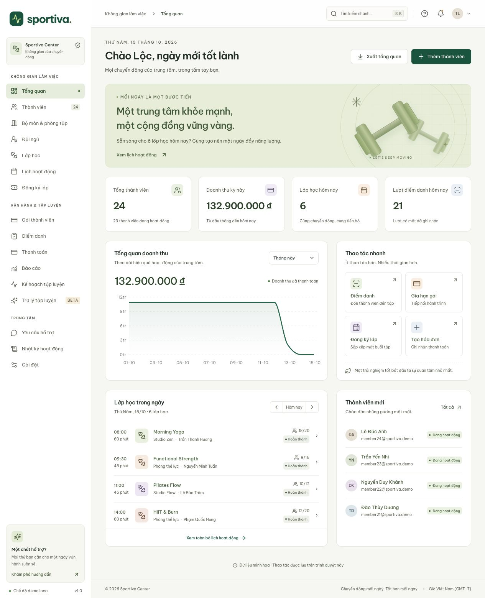

# Kết quả kiểm thử frontend

Ngày: 15/10/2026. Node 24.14.1, npm; React 19 / TypeScript strict / Vite. Kiểm tra trên máy local. Backend và SQL Server thật chưa chạy trong phiên này.

## Các kiểm tra đã pass

| Kiểm tra               | Kết quả                                     |
| ---------------------- | ------------------------------------------- |
| `npm run typecheck`    | Pass, không có lỗi TypeScript               |
| `npm test`             | **79 test / 7 file pass**                   |
| `npm run build`        | Pass, tạo `dist/`, lazy route + chart chunk |
| `npm run format:check` | Pass                                        |
| `git diff --check`     | Pass                                        |
| npm dependency audit   | 0 vulnerabilities sau khi nâng Vitest       |
| So sánh snapshot BE    | 82/82 file giống nội dung commit upstream   |
| So sánh FE gốc         | 25/25 file giống nội dung commit upstream   |

## Kiểm thử tự động

- **Contract BE / gateway**: route `/users/{id}/status`, field của ClassRequest/AttendanceRequest/InvoiceRequest, memberId booking qua query, LocalDateTime không Z, pending invoice list, empty success body, Bearer token không lấy từ demo.
- **Lỗi và phiên**: 400 message, 401 expiration event, lỗi network không fallback demo, JSON array contract, phát hiện HTML do proxy sai, session không hợp lệ, logout xóa query cache.
- **RBAC**: anonymous deep-link về login; MEMBER/COACH/RECEPTIONIST bị chặn manager route; CENTER_MANAGER/MANAGER được phép.
- **Nghiệp vụ demo**: tạo trùng user, sở hữu membership/booking, booking trùng, capacity sau hủy/đăng ký lại, hủy lớp kéo theo booking, xung đột phòng/HLV, capacity phòng, attendance trùng, chặn gói active thứ hai, renew tính từ hôm nay, invoice PENDING→PAID→REFUNDED và quyền refund, revenue loại pending/refund, thao tác lỗi không lưu một phần, khôi phục JSON hỏng, audit action.
- **UI**: tìm tiếng Việt có/không dấu gồm chữ Đ; pagination sau lọc; form lỗi giữ mở; dialog có tên và Escape.
- **Timezone**: naive BE datetime hiểu là UTC+7; LocalDate không lệch ngày; UTC timestamp hiển thị GMT+7; chuyển ngày lúc 17:00 UTC; datetime-local và qua cuối tháng.
- **CSV**: BOM UTF-8, quote/comma/newline, null, chống formula injection gồm tiền tố khoảng trắng/tab.
- **Route smoke**: cả 17 trang quản lý (dashboard, profile và 15 màn nghiệp vụ) render qua router/provider/query thực trong jsdom, không rơi vào error boundary.

## Kiểm tra trực tiếp trên trình duyệt

Đã dùng browser local và chỉ dữ liệu demo tự tạo. Chuỗi thao tác:

1. Manager đăng nhập qua lựa chọn demo; tạo thành viên QA; tìm lại bằng tên không dấu.
2. Chọn thành viên QA, đăng ký Signature; kiểm tra lịch sử có ngày bắt đầu/hết hạn.
3. Tạo invoice 2.100.000đ gắn subscription đó, xác minh PENDING và thông tin phiếu thu; xác nhận đã thu, trạng thái chuyển PAID.
4. Tạo lớp Yoga tương lai, gán HLV/phòng/sức chứa; đăng ký QA member, capacity giảm 20→19 và xuất hiện trong roster.
5. Điểm danh thành viên chờ trong Functional Strength, xuất hiện trong history với người ghi nhận và thời gian.
6. Đổi sang MEMBER: dashboard cá nhân, không có link Báo cáo; mở trực tiếp `/reports` bị chặn. Tra lịch bằng trợ lý demo, tạo mẫu tập, lưu và thấy trong kế hoạch.
7. Đổi sang COACH: chỉ lớp phụ trách; không có Thanh toán; mở kế hoạch, ghi kết quả và nhận xét, số kết quả tăng.
8. Đổi sang RECEPTIONIST: có Thanh toán, không có Báo cáo.
9. Bản **production build** tại `127.0.0.1:4173`: đi qua đủ 15 màn nghiệp vụ và quay về tổng quan, không phát sinh console error ở origin production.
10. Mobile **390×844**: kiểm tra dashboard và class cards, menu mở/đóng, không có document horizontal overflow; form có label đúng; Tab từ nút cuối quay lại nút đóng, Escape đóng modal. Đã trả viewport về mặc định.
11. Khôi phục demo tại origin dev sau QA để không để lại dữ liệu kiểm thử tự tạo. Preview production dùng dữ liệu mẫu sạch.

Trong giai đoạn sửa source có reload/HMR; các lỗi phát hiện (chuẩn hóa Đ, import parseDate) đã sửa và thêm regression test. Smoke test cuối chạy trên build production, không phụ thuộc trạng thái HMR.

## Ảnh kiểm chứng

- [Dashboard desktop đầy đủ](screenshots/dashboard-desktop.jpg)
- [Dashboard preview](screenshots/dashboard-preview.jpg)
- [Dashboard mobile](screenshots/dashboard-mobile.jpg)
- [Lớp học mobile](screenshots/classes-mobile.jpg)

## Chưa được xác minh

- Login/JWT/403 thực với BE đang chạy, proxy/CORS, SQL Server migration và dataset thực.
- Authorization object-level và cạnh tranh request ở backend.
- Docker image/Nginx chạy thật (đã chuẩn bị config, chưa build container).
- Print dialog/PDF output của từng trình duyệt và hóa đơn điện tử. Phiếu thu chỉ là tài liệu nội bộ.
- Lighthouse/WCAG audit đầy đủ, Safari/Firefox, screen reader thật và tải dữ liệu lớn.
- AI inference, email/push notification, cổng thanh toán: backend chưa cung cấp.

Các test fetch dùng response mock và các test UI dùng fixtures demo. Chúng không thay thế UAT/integration test với BE/database thật. Xem `AUDIT.md` để biết blocker trước production.
